## Summary
Dashboard that shows every Claude project's summary, phase and next steps from `PROJECT_STATUS.md` files, with checkboxes that sync back to GitHub. It's live on GitHub Pages and tracking piano-trainer, VideoTagger and Financial-Dashboard. What's left is desktop setup (global CLAUDE.md, Cowork).

## Next steps
- [x] Merge `claude/project-manager-dashboard-k76ee7` into `main`
- [x] Make this repo public, then Settings → Pages → Source: GitHub Actions
- [x] Create private repo `project-tracker-data` with `projects.json` (include this repo)
- [x] Create fine-grained token (Contents: read/write, all repositories) and connect the dashboard
- [x] Add piano-trainer, VideoTagger and Financial-Dashboard to the token's repository access
- [x] Paste the "Global instruction for Claude Code on your PC" note into `~/.claude/CLAUDE.md` on the PC
- [x] Add status files and the CLAUDE.md snippet to piano-trainer, VideoTagger and Financial-Dashboard
- [ ] Set up Cowork with a local clone of `project-tracker-data`
- [ ] Optional: point custom domain at GitHub Pages
- [x] Build dashboard (overview, open actions, project detail, tick write-back)
- [x] Pages deploy workflow, templates, README

## Key info
- Dashboard URL (after Pages is on): https://phillbagnall.github.io/Claude-Project-Manager/
- Data repo: `phillbagnall/project-tracker-data` (private), registry file `projects.json`
- The token is stored only in each browser's localStorage, so each device must be connected separately
- The token has access to **all repositories**, so new projects only need adding to projects.json (no token changes)

## Notes
- 2026-11-07 (Claude): How to add another project to the dashboard
  - Easiest: in a Claude session on that repo, say "Set this repo up for my project tracker". Claude writes PROJECT_STATUS.md and the CLAUDE.md section, and adds the repo to projects.json (attach project-tracker-data to the session too)
  - By hand: copy `templates/PROJECT_STATUS.md` into the repo root and paste `templates/CLAUDE.md.snippet` into its CLAUDE.md
  - Add a line to `projects.json` in project-tracker-data: `{ "id": "my-project", "repo": "phillbagnall/my-project" }`
  - Tap ↻ on the dashboard
  - No repo (e.g. Cowork work)? Add `projects/<name>.md` to project-tracker-data, with `"path": "projects/<name>.md"` in its projects.json entry
- 2026-11-07 (Claude): How to add a new chat to the dashboard
  - Claude Code session (web, mobile or desktop) on a repo that's already tracked: nothing to do. The repo's CLAUDE.md tells it to keep PROJECT_STATUS.md updated
  - New Claude Code session on an untracked repo: say "Set this repo up for my project tracker", then follow the "add another project" note above (adds it to projects.json)
  - Ask any session to "add a note" and it appends a dated note, marked as Claude's, to that project's Notes. It never edits or deletes existing notes unless you ask
  - Ordinary claude.ai chat (no repo): ask it to "write a PROJECT_STATUS.md for this chat in the dashboard format". On GitHub, add it to project-tracker-data as `projects/<name>.md`, then add `{ "id": "<name>", "repo": "phillbagnall/project-tracker-data", "path": "projects/<name>.md" }` to projects.json. To update it later, ask the chat for a fresh version and paste it over the old one
  - Cowork: same as a claude.ai chat, but Cowork can edit `projects/<name>.md` directly in a local clone of project-tracker-data and push it
- 2026-11-07 (Claude): Prompt for adding a PC project (no repo yet)
  - Open a Claude Code chat in the project's folder on your PC, tap Copy below and paste it in. Afterwards just tap ↻
  - Same text as `templates/ADD_PROJECT_PROMPT.md`; if one changes, update the other
  ```text
  Please add this project to my project dashboard (https://github.com/phillbagnall/Claude-Project-Manager). Work through these steps in order, and stop to ask me where it says so.

  1. Name: suggest a GitHub repo name from this folder's name (spaces to "-", no symbols; e.g. "AE - Walkthrough" -> "AE-Walkthrough"). Read the project and tell me in one line what you think it is. Ask me to confirm both.

  2. Safety check before committing anything: list (a) files over 100 MB (GitHub rejects them; renders, footage and other media are common culprits), (b) anything that looks like a secret (.env files, keys, tokens, passwords), and (c) generated output (builds, caches, renders, node_modules and similar). Propose a .gitignore that leaves these out and ask me to OK it. Never commit secrets.

  3. Git: if this folder isn't a git repo yet, run git init. Commit the project. If it already is a repo with a remote, tell me and use that instead of creating a new one.

  4. GitHub: create a PRIVATE repo phillbagnall/<name> and push. If the gh CLI is installed and logged in, use: gh repo create <name> --private --source . --push. If not, ask me to create an empty private repo with that exact name at https://github.com/new (no README), then add it as the remote and push.

  5. Status file: create PROJECT_STATUS.md in the repo root using this format (frontmatter + sections). Fill it in from what's actually in the project: a 2-4 sentence summary, concrete next steps as checkboxes, and key info (how to run it, where things live; never secrets). Set updated to today, phase to your best guess (Idea | Planning | Building | Testing | Shipped | Paused), priority medium unless I say otherwise, and links to the repo URL.

  ---
  name: <Project name>
  phase: Building
  priority: medium
  updated: YYYY-MM-DD
  blocked: false
  links: [https://github.com/phillbagnall/<name>]
  ---
  ## Summary
  ## Next steps
  - [ ] ...
  ## Key info
  ## Notes
  ## Visuals
  ## Decisions
  ## Log
  - YYYY-MM-DD: Added to the project dashboard

  6. CLAUDE.md: download https://raw.githubusercontent.com/phillbagnall/Claude-Project-Manager/main/templates/CLAUDE.md.snippet and append it to CLAUDE.md in the repo root (create the file if it doesn't exist; keep anything already there). Commit both files and push.

  7. Register it: add {"id": "<name in lowercase>", "repo": "phillbagnall/<name>"} to the "projects" list in projects.json in my private repo phillbagnall/project-tracker-data. Keep the existing entries and keep the JSON valid. Use a temporary shallow clone (edit, commit, push, then delete the clone) or the gh API. If you can't get access, show me the exact line to add on GitHub myself.

  8. Finish by giving me the repo URL and telling me to tap refresh on the dashboard. (My dashboard token has access to all my repos, so nothing else is needed.)
  ```
- 2026-11-07 (Claude): Global instruction for Claude Code on your PC
  - Makes every new Claude Code chat on your PC offer to add an untracked project to the dashboard (answer yes, not now, or never)
  - Tap Copy and paste it at the end of `C:\Users\<you>\.claude\CLAUDE.md` (create the file if it doesn't exist). Only Claude Code on that PC reads it
  - Same text as `templates/GLOBAL_CLAUDE.md`; if one changes, update the other
  ```text
  ## Project dashboard

  I track my projects on a dashboard (https://github.com/phillbagnall/Claude-Project-Manager) that reads PROJECT_STATUS.md from the root of each project's GitHub repo.

  - If this project has a PROJECT_STATUS.md: keep it up to date as its CLAUDE.md describes. If its CLAUDE.md has no "Project status file (dashboard)" section, follow https://raw.githubusercontent.com/phillbagnall/Claude-Project-Manager/main/templates/CLAUDE.md.snippet instead.
  - If it doesn't, and this folder is a real project (not my home folder, Downloads, Desktop or a temporary folder), ask me once near the start of the session: "This project isn't on your dashboard yet. Want me to add it?"
    - Yes: follow the steps in https://raw.githubusercontent.com/phillbagnall/Claude-Project-Manager/main/templates/ADD_PROJECT_PROMPT.md (the text block in that file).
    - Not now: don't ask again this session.
    - Never: create an empty file named .no-dashboard in the project root and commit it. Never ask in a folder that has that file.
  - When I ask you to "add a note", append it to the ## Notes section of PROJECT_STATUS.md as "- YYYY-MM-DD (Claude): text" (extra lines as indented sub-points), then commit and push.
  - When a session makes a visible change to a tracked project, add the 1-3 screenshots you already took that best show it to its ## Visuals section, as its CLAUDE.md describes. Don't open images just to describe them, and don't back-fill old ones unless I ask.
  ```
- 2026-11-08: Add the ability to edit user made notes, but not Claude notes. Put a Claude logo on Claude created notes, and a user icon on user created ones.
- 2026-11-08: Add section for visuals created by Claude, such as screenshots or video, along with a brief description and where in the build the snapshot is from. Upload all unless otherwise specified by the user. If possible, upload previous content from before the project manager was created.
- 2026-11-09: To-Do (all done 2026-11-09)
  - Done: Collapsible sections in a project.
  - Done: Cycle through visuals by using arrow keys, swiping on a phone, or arrow buttons on screen, just like a gallery view.
  - Done: Auto-fit width for Windows and Mac, just like I have for the phone view.
  - Done: Ability to delete user-created notes as well.

## Visuals
- 2026-11-07: Sign-in screen: connect the data repo and token, or try demo data
  - Build: first version (2303107)
  - 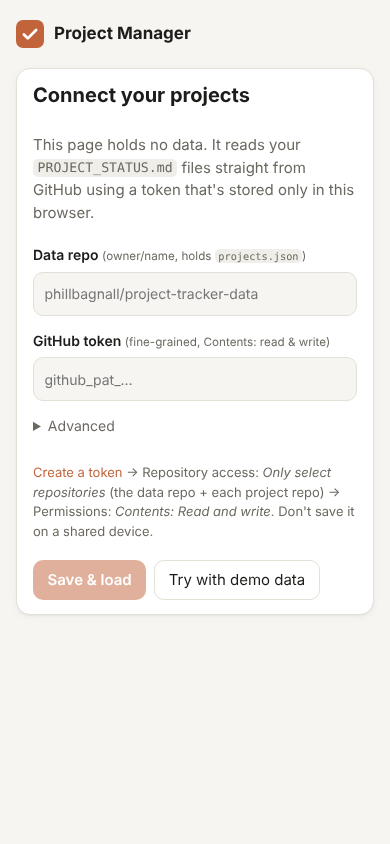
- 2026-11-07: Project overview on a phone (demo data)
  - Build: first version (2303107)
  - 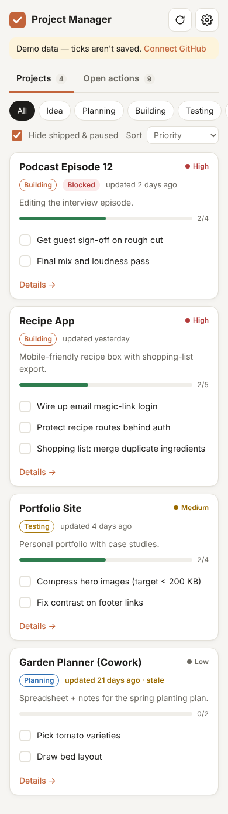
- 2026-11-07: Project overview on desktop, dark mode (demo data)
  - Build: first version (2303107)
  - 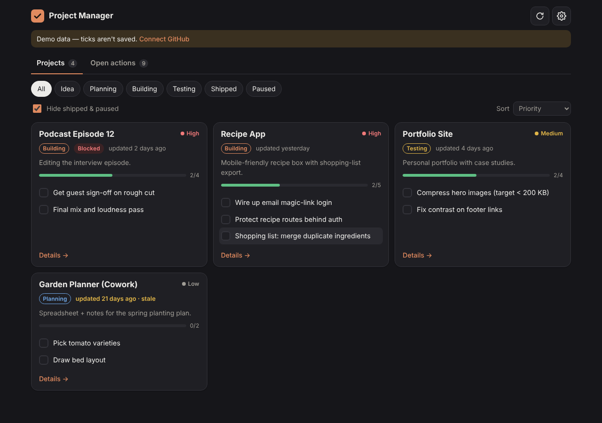
- 2026-11-07: Project page: summary, checklist, key info, decisions and log
  - Build: first version (2303107)
  - 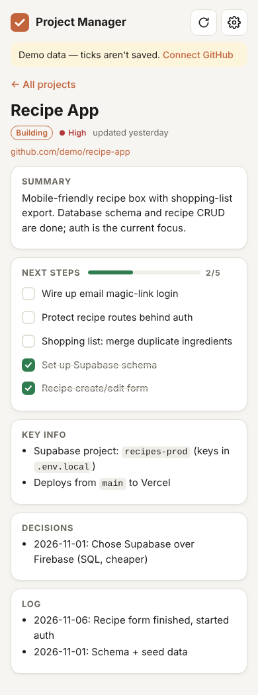
- 2026-11-07: Notes with the Add note box (test data)
  - Build: project notes (812ecad)
  - 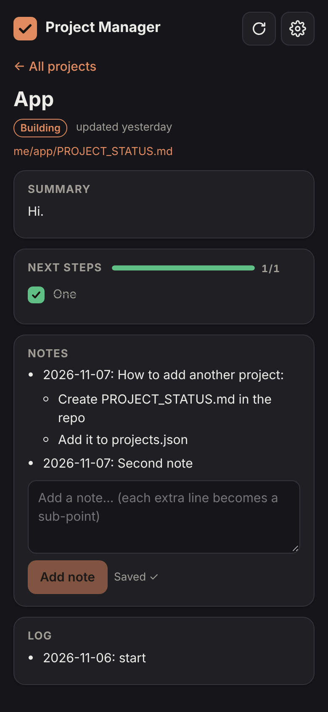
- 2026-11-07: Notes as separate collapsible cards, one opened
  - Build: note cards (febaf33)
  - 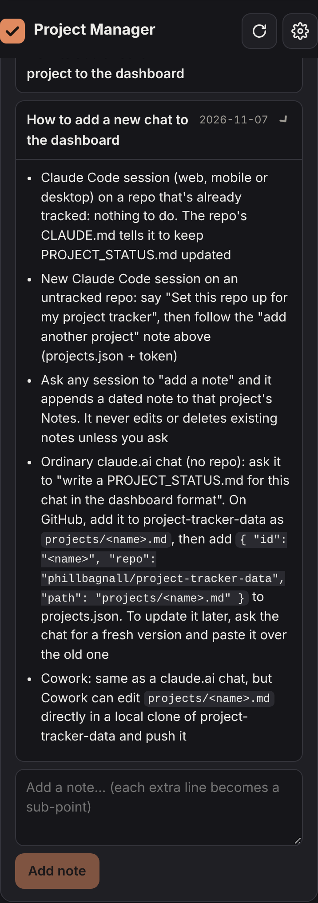
- 2026-11-07: Copyable add-project prompt inside a note
  - Build: copyable code blocks (2615aa7)
  - 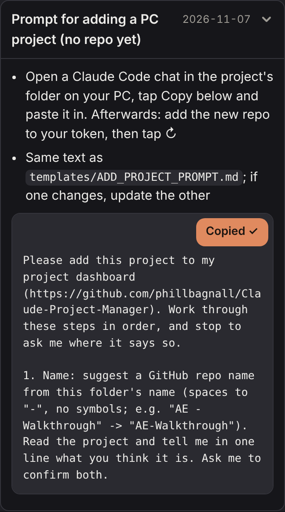
- 2026-11-07: Overview with every project card collapsed
  - Build: collapsible cards (1e78ad9)
  - 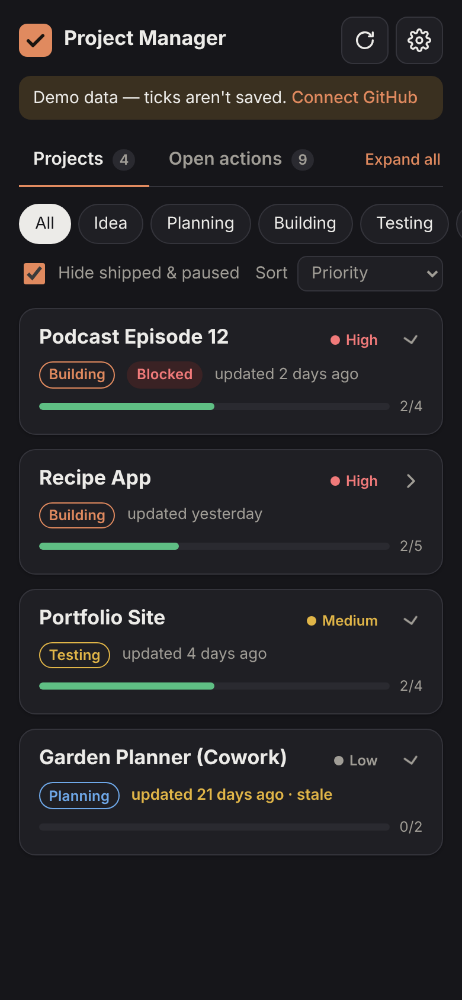
- 2026-11-08: Tile colour picker on a project page
  - Build: tile colours (1fe3ee7)
  - 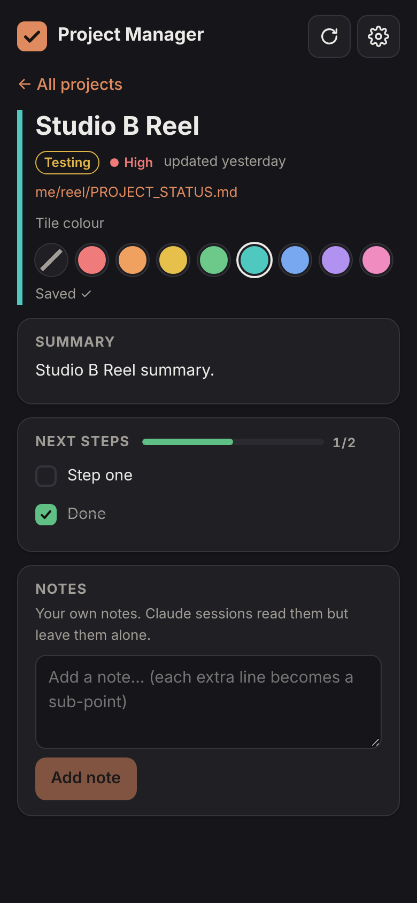
- 2026-11-08: Colour-coded tiles, light mode (test data)
  - Build: tile colours (1fe3ee7)
  - 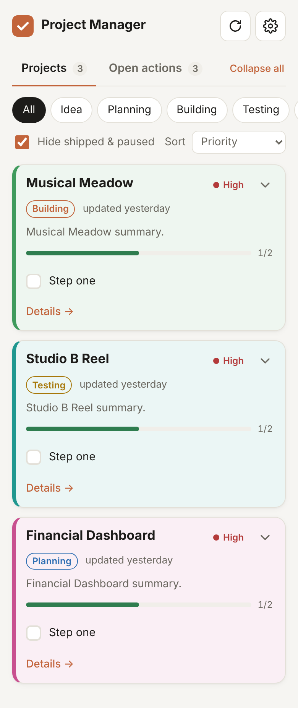
- 2026-11-08: Open actions grouped by project, in tile colours
  - Build: colours on Open actions (40bf9cc)
  - 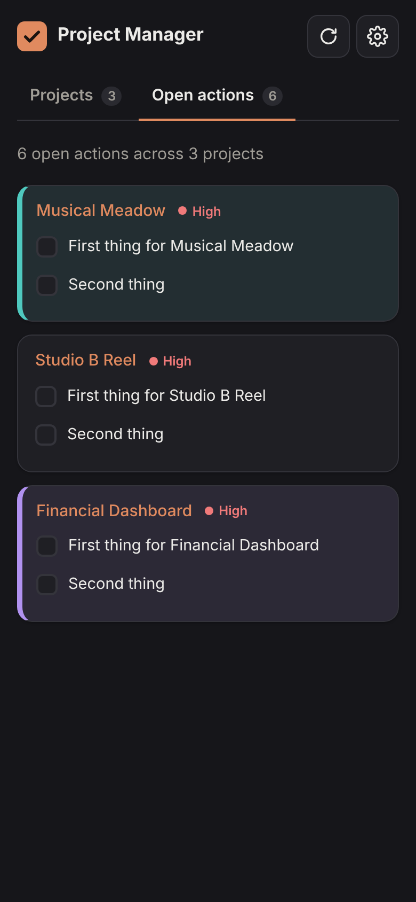
- 2026-11-08: Renaming a project from its page
  - Build: rename (f263c3a)
  - 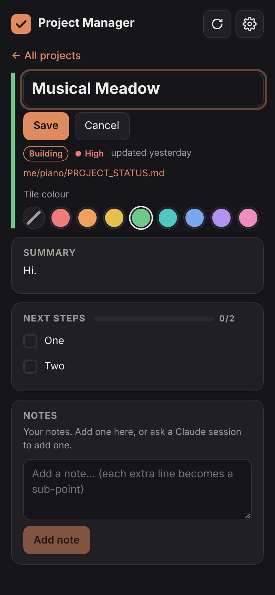
- 2026-11-09: Note cards showing who wrote them (Claude or you), with edit on your own
  - Build: note authors and Visuals (772aa6f)
  - 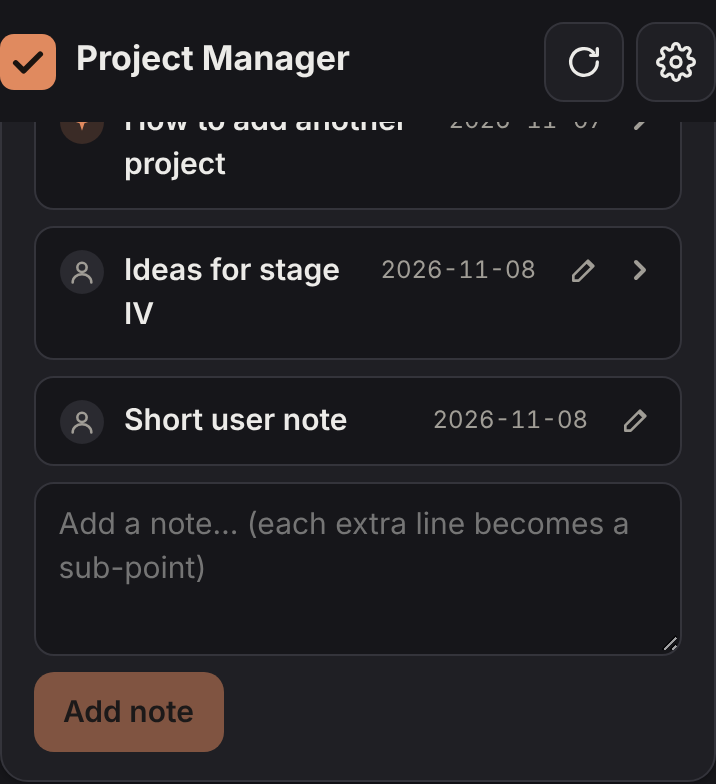
- 2026-11-09: Editing one of your own notes
  - Build: note authors and Visuals (772aa6f)
  - 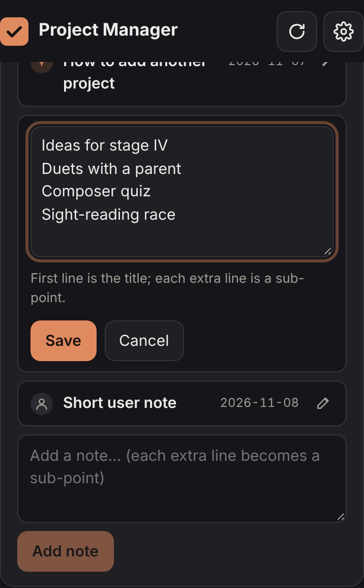
- 2026-11-09: The Visuals gallery on a project page (test data)
  - Build: note authors and Visuals (772aa6f)
  - 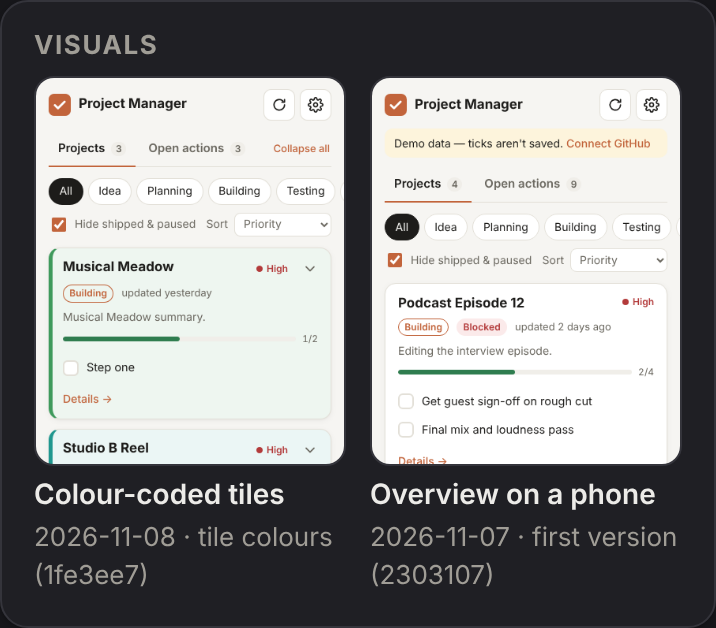
- 2026-11-09: Project page on a wide desktop window with every section collapsed (test data)
  - Build: collapsible sections, gallery, full width (0ce6319)
  - 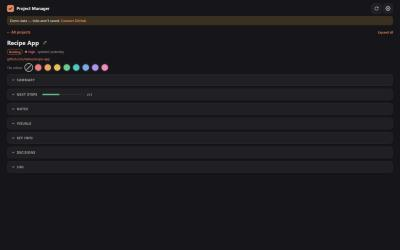
- 2026-11-09: Visuals gallery on a phone, with previous/next arrows and counter (test data)
  - Build: collapsible sections, gallery, full width (0ce6319)
  - 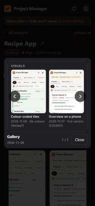

## Decisions
- 2026-11-07: Public code + private data repos, so GitHub Pages hosting stays free
- 2026-11-07: Status file lives in each project's own repo; updates are automatic via CLAUDE.md instruction
- 2026-11-07: Vite + React + TS static site, no backend

## Log
- 2026-11-09: Did the 2026-11-09 to-do: collapsible project sections (Collapse all / Expand all), gallery navigation in Visuals (arrow keys, swipe, on-screen arrows), full-width layout on desktop, and deleting your own notes
- 2026-11-09: Softened the Visuals rule (1-3 per visible change, no opening images just to describe them, no back-fill unless asked) to save usage
- 2026-11-09: Added 15 screenshots from building the dashboard to Visuals
- 2026-11-09: Note authors (Claude/you icons), edit your own notes, and a Visuals gallery for Claude's screenshots/videos
- 2026-11-08: Token now covers all repositories; removed 'add the repo to your token' steps from notes, prompt and README
- 2026-11-08: Rename projects from their page (✏️ next to the title)
- 2026-11-08: Tile colours also shown on the Open actions tab
- 2026-11-08: Tile colours (set on each project page, saved in projects.json); Back always returns to the overview
- 2026-11-07: Collapsible project cards on the overview (Collapse all / Expand all)
- 2026-11-07: Added global PC instruction (templates/GLOBAL_CLAUDE.md + note)
- 2026-11-07: Full add-project prompt in Notes with a Copy button
- 2026-11-07: Made the dashboard installable as a phone app (manifest, icons, service worker)
- 2026-11-07: Added a generic prompt for adding PC projects
- 2026-11-07: Notes shown as separate collapsible cards
- 2026-11-07: Claude can now add notes on request; added "new chat" note
- 2026-11-07: Added notes (Add note box on each project page)
- 2026-11-07: Live on Pages; connected piano-trainer, VideoTagger and Financial-Dashboard
- 2026-11-07: Planned on mobile, built and tested v1 in a cloud session
